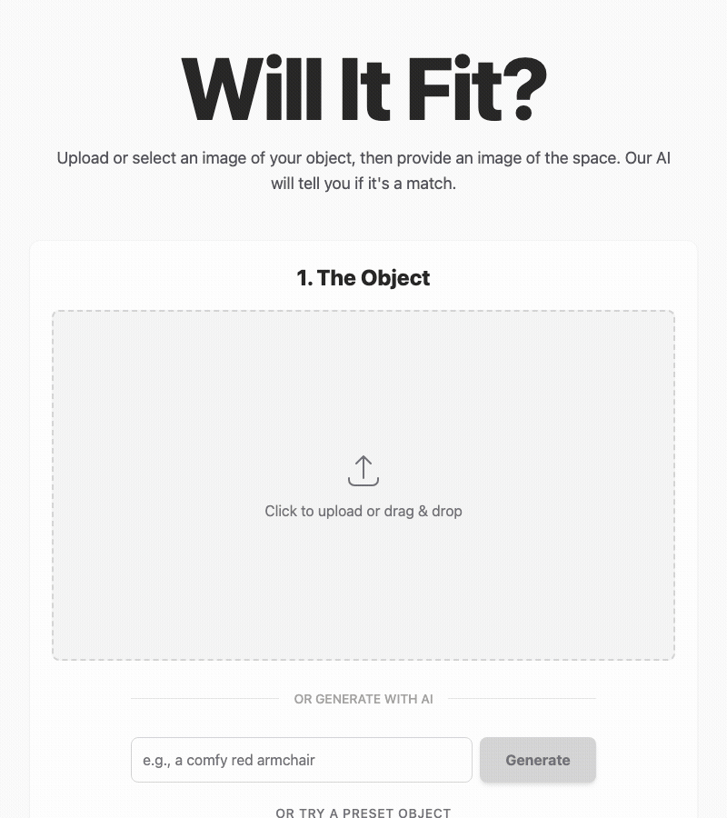
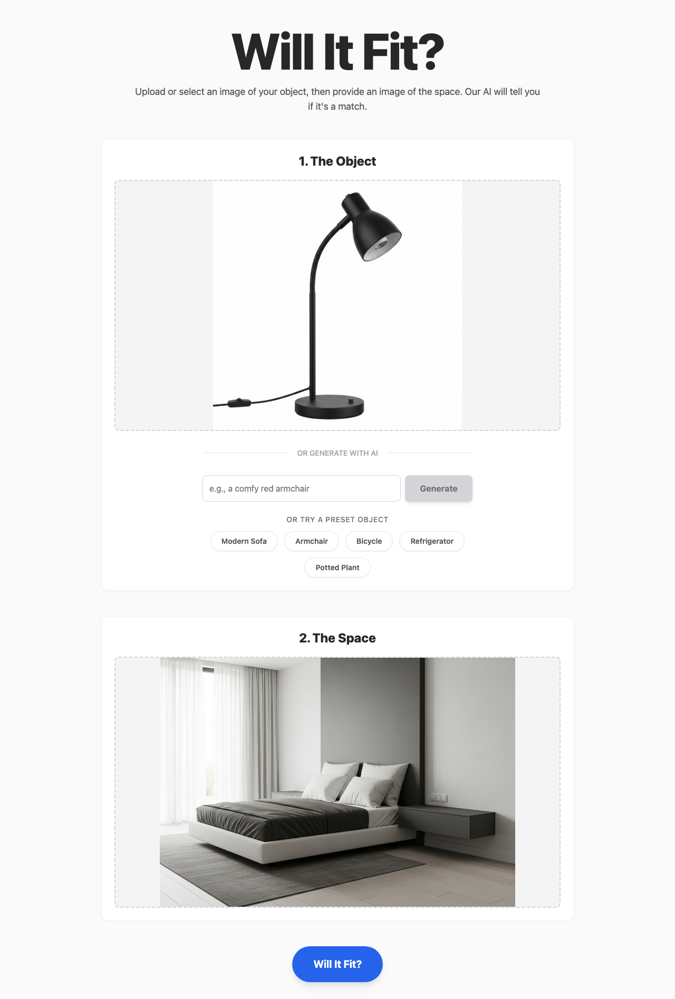
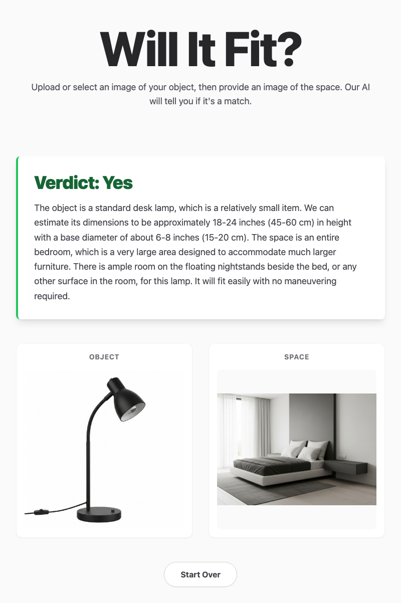

# Will It Fit?

Snap a photo of your furniture (or generate one with AI), snap a photo of the doorway, and let Gemini tell you if you're about to have a very bad moving day.

## Quick Start

```bash
git clone https://github.com/andrewvoirol/ais-will-it-fit.git
cd ais-will-it-fit
npm install
```

Add your Gemini API key to `.env.local`:

```
VITE_GEMINI_API_KEY=your_key_here
```

Get a free key at [aistudio.google.com/apikey](https://aistudio.google.com/apikey), then:

```bash
npm run dev
```

## How It Works

1. **Upload or generate an object** — drag a photo into the "Object" zone, or type a description and let Imagen 4.0 generate one. Quick presets (sofa, armchair, bicycle, etc.) are one click away.
2. **Upload a photo of the space** — your doorway, hallway, stairwell, whatever the object needs to pass through.
3. **Hit "Will It Fit?"** — Gemini 2.5 Flash analyzes both images, estimates dimensions using visual cues (door knobs, light switches, known object sizes), considers diagonal tilting and maneuvering, and returns a verdict: **Yes**, **Tight**, or **No** with a detailed explanation.





## Tech Stack

| Layer | Tech |
|-------|------|
| Framework | React 19 + Vite |
| Language | TypeScript |
| Styling | Tailwind CSS 3 |
| AI (Vision) | Gemini 2.5 Flash |
| AI (Image Gen) | Imagen 4.0 |
| API | Google GenAI SDK |

## Project Structure

```
├── App.tsx                  # Main app component + state management
├── components/
│   ├── Header.tsx           # Title + tagline
│   ├── ImageUploader.tsx    # Drag-and-drop file upload
│   ├── ImageGenerator.tsx   # AI image generation form
│   ├── ProductSelector.tsx  # Preset object quick-picks
│   └── Spinner.tsx          # Loading indicator
├── services/
│   └── geminiService.ts     # Gemini API integration
├── data/
│   └── products.ts          # Preset object definitions
└── types.ts                 # TypeScript interfaces
```

## License

Apache-2.0
